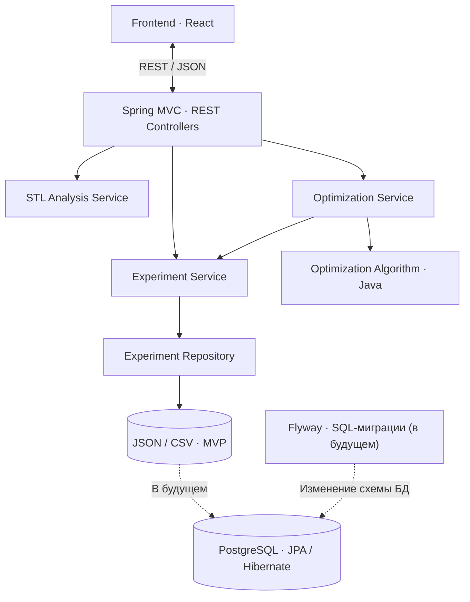

# Backend

 — исследовательский проект по оптимизации параметров 3D-печати, разрабатываемый в рамках подготовки к «Политехнике» МГТУ им. Н. Э. Баумана.

Этот репозиторий содержит серверную часть приложения. Backend предоставляет REST API для frontend-приложения на React, обрабатывает входные данные, анализирует STL-модели и рассчитывает рекомендуемые параметры заполнения на основе результатов физических экспериментов.

## Для чего нужен backend

Основные задачи серверной части:

- Принимать STL-файлы, проверять их корректность и получать базовые характеристики геометрии.
- Принимать параметры расчёта: материал, условия нагружения, параметры печати и ограничения.
- Получать результаты проведённых экспериментов.
- Подбирать оптимальный процент заполнения **в пределах исследованных моделей и сопоставимых условий испытаний**.
- Возвращать результат и экспериментальные данные для отображения на frontend.


## Технологический стек

**Сейчас:**

- Java 25
- Spring Boot + Spring MVC — REST API
- Maven — сборка и управление зависимостями
- Jackson — сериализация и десериализация JSON
- Lombok — сокращение шаблонного кода
- JUnit 5 — модульное тестирование
- JSON — хранение экспериментальных данных без базы данных на этапе MVP

**Планируется позже:**

- PostgreSQL — постоянное хранение моделей, экспериментов и результатов расчётов
- Spring Data JPA + Hibernate — доступ к данным
- Flyway — версионирование схемы PostgreSQL и применение SQL-миграций
- Выделение самостоятельных модулей и, при необходимости, микросервисов

## Архитектура

На этапе MVP используется **модульный монолит**: одно Spring Boot-приложение с разделением ответственности между компонентами. Отдельные микросервисы пока не нужны.



**Логика работы:**

1. Frontend отправляет STL-файл и параметры расчёта через REST API.
2. Контроллер проверяет запрос и передаёт его соответствующему сервису.
3. Сервис анализа STL определяет базовые характеристики модели и возможность сопоставления с исследованными образцами.
4. Сервис оптимизации получает экспериментальные данные и передаёт их Java-алгоритму.
5. Алгоритм выбирает подходящую экспериментально проверенную конфигурацию с учётом ограничений пользователя.
6. Backend возвращает рекомендацию, данные для сравнения и информацию об ограничениях расчёта.

## Локальный запуск

Необходимы **JDK 25** и **Maven**.

```bash
mvn clean test
mvn spring-boot:run
```

Команды предполагают, что Maven установлен и проект уже содержит стандартную конфигурацию Spring Boot. Для сборки артефакта:

```bash
mvn clean package
```

## Правила работы с Git и Merge Request

В репозитории используются две основные ветки:

- **`main`** — стабильная версия проекта. Прямые коммиты не допускаются.
- **`develop`** — общая ветка разработки, в которую вливаются задачи после проверки.

### Порядок выполнения задачи

1. Выбрать задачу в трекере и ознакомиться с её описанием.
2. Обновить локальную ветку `develop`.
3. Создать **отдельную ветку от `develop`** с номером задачи и кратким названием.
4. Выполнить изменения, проверить сборку и тесты.
5. Отправить свою ветку в удалённый репозиторий.
6. Создать **Merge Request в `develop`**, указав **номер задачи и ссылку на неё**.
7. Дождаться code review, исправить замечания и только затем выполнить merge.

**Оформление Merge Request:**

- **Заголовок:** `[APP-123] Реализовать анализ STL`
- **Source branch:** `feature/APP-123-stl-analysis`
- **Target branch:** `develop`
- **Описание:** ссылка на задачу, краткое описание изменений, способ проверки и при необходимости скриншоты/примеры запросов.

Ссылку на задачу размещаем **в описании MR**; в названии ветки достаточно номера задачи — полноценный URL в имени Git-ветки не нужен.

### Условия принятия MR

- Изменения соответствуют задаче.
- Проект собирается, тесты проходят.
- Новая логика по возможности покрыта JUnit-тестами.
- Отсутствуют случайные изменения и секреты в репозитории.
- MR проверен одним из лидов команды.

Перенос изменений из `develop` в `main` выполняется отдельным MR при подготовке стабильной версии.
